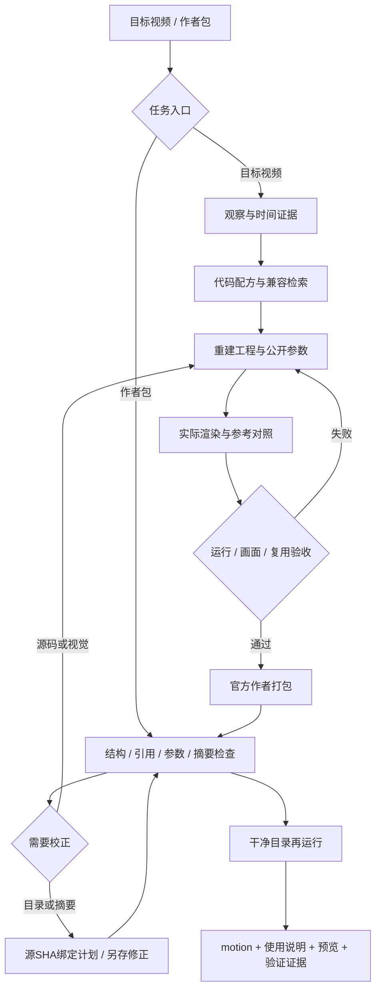

# Motion Template Studio｜视频转模板、检查与校正

**前期核心：目标视频 → 观察证据 → 代码重建 → 参数通用化 → 验证 → 新的作者 `.motion`。**

仓库承担四项工作：帮助识别参考视频的展示方法；检索适用代码结构；检查并校正作者包；保存回归案例和真实验证证据。Skill负责组织分析和编写代码，MCP提供有边界的检索与校验工具，运行器与FFmpeg产生可复核结果。

GitHub私有仓库：[wakazhangjiahuang/motion-template-studio](https://github.com/wakazhangjiahuang/motion-template-studio)。main已恢复规范目录；初次压平上传保留于backup/upload-flat-20261117。

## 主链路

图中“通过”要求相关证据已执行；结构通过仍需后续运行/画面/复用验收。环境阻断时保留待验候选。个人授权封套进入公开使用入口，不走作者校正分支。

## 各模块的核心合同

| 模块 | 输入→输出 | 质量判据 |
|---|---|---|
| 视频接入 | 实际视频→哈希/时基/媒体元数据 | 精确源路径和时长；不能凭文件名推断全片 |
| 观察拆解 | 连续审看+相邻帧→observations | 事实/推断/未知分开，场景覆盖至片尾 |
| 代码检索 | 展示特征+引擎→配方/源码证据 | 先兼容、再视觉；词项排序不是识别置信度 |
| 代码重建 | 观察合同+可用结构→实际工程 | 保留接口并针对性改组件；不播放参考MP4冒充重建 |
| 通用化 | demo工程→参数/素材/容量合同 | 参数被真实消费，超容不裁字、不删内容 |
| 实际渲染 | 工程+实例输入→逐帧预览/声音 | 独立seek、字体ready、A/V正确、完整解码 |
| 包检查 | 作者包→结构/引用/preset/摘要报告 | 不执行嵌入代码；STATIC_PASS与视听状态分别记录 |
| 自动校正 | 缺陷包+源SHA计划→新包 | 仅单层根展平、完整性重建；保留原包 |
| 人工/代码校正 | 画面/逻辑缺陷→工作副本修改 | 依据观察定位，修改后重渲染/打包/复测 |
| 交付复核 | 新motion→干净目录导出与说明 | 源/输出哈希、版本、命令、真实预览和已知限制 |
| 知识回流 | 问题/修复/反例→案例库 | 来源、许可、引擎、验证状态和失效条件齐全 |

后期A数字人口播、B素材混剪由新模板承接，属于后续生产任务。本仓库先保证前期模板可读、能运行、可替换、可验证；不默认改写用户内容。

## 从这里开始

- 已安装的个人Skill与私有插件：见 `docs/installation-status.json`。
- 使用Skill：上传目标视频，发送 `使用 $motion-template-studio，将本轮目标视频做成完整可复用.motion，附使用说明、预览和真实验证；保留原素材。`
- 只检查校正：发送 `使用 $motion-template-studio，检查本轮作者.motion，保留原件，另存修正版，列出已验证与待验证项。`
- 技能本体：`skills/motion-template-studio/SKILL.md`。
- 规范和adu架构：技能 `references/source-contracts.md`。
- 运行与检查：`docs/local-setup.md`；MCP：`mcp.example.json`。
- GitHub上传：`docs/github-upload.md`。
- 当前实测报告：`verification/current-check.json`；原始构建历史：`verification/summary.json`。
- 完整启动Prompt：`docs/start-prompt.md`。

## 本次交付状态

已完成静态校验器、非破坏性修复器、诊断工程、公共官方工具核验/打包封装、视频元数据/抽帧/解码工具，以及8个实际stdio MCP工具。36项回归检查、20项实际联调检查通过；仓库独立MCP入口另通过11项协议检查。

初次本地浏览器渲染受环境阻断；现已在GitHub实际环境通过6项浏览器/音频/打包与干净目录重跑检查，详见verification/current-check.json和[Actions实测](https://github.com/wakazhangjiahuang/motion-template-studio/actions/runs/44041662740)。诊断测试不认证任意目标视频的复刻质量。诊断包仅验证打包链路；正式目标模板仍需在声明的Codex/WorkBuddy等宿主中完成参考对照、试听、新内容与干净目录验收。MCP为本地stdio代码，未部署云服务。

## 资料范围

`sources/adu-motion-video/`保留935份代码、契约、文档与测试，逐文件Git blob哈希匹配固定提交，详见source-manifest.json。排除了图像、字体、音视频及演示输出，不能把该参考快照当作已安装且依赖齐全的上游运行环境。

MotionGit保留精确内容Schema、公开版本/摘要清单及原创操作摘要。官方作者工具使用时从公开官网获取，未擅自打入再分发包。个人下载包、凭据、私有参考视频未纳入仓库。

许可见LICENSE、THIRD_PARTY_NOTICES.md与上游许可。Private仓库仅控制访问范围，不替代素材分发授权。
